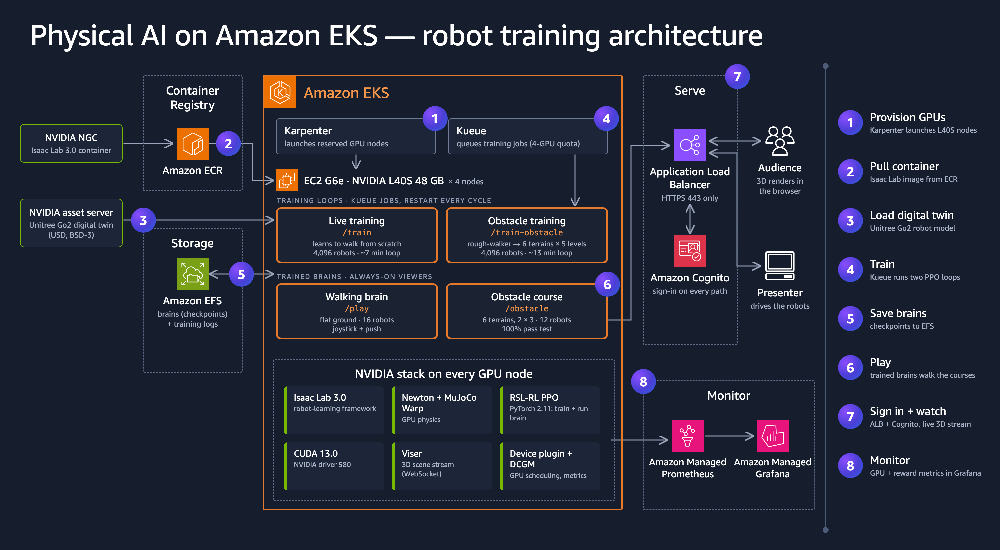
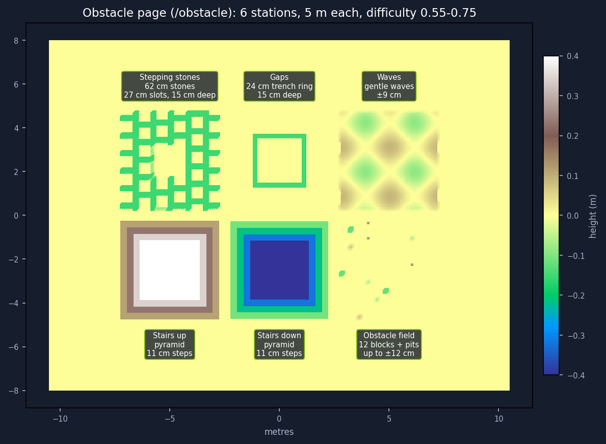

## Introduction

Recently I've been researching Physical AI, and with a little (OK, a LOT of) help from Claude I
built an NVIDIA Isaac Lab setup that trains digital twins of the Unitree Go2 robot to walk, climb
and navigate different terrains. That's roughly **two months of practice, squeezed into under an
hour of training**, on Amazon EKS with 4× EC2 G6e (NVIDIA L40S) GPU nodes.

The trick is simulation. Physical AI (robots that *learn* a behaviour instead of having it
hand-coded) gets trained in a physics simulator first. A simulator runs thousands of robots in
parallel, nothing breaks when they fall over, and you can reset them a million times. Only once a
policy works in sim do you move it to real hardware.

This post covers how I put that together with NVIDIA Isaac Lab on Kubernetes: what runs where, what
a training "iteration" actually buys you, how a Unitree Go2 goes from rough ground to a 100% pass
rate on an obstacle course, and the config bits that matter. The full step-by-step build is in the
repo's README, so I won't repeat it here.

Code: [github.com/sc13912/physical-ai-isaac-go2-eks](https://github.com/sc13912/physical-ai-isaac-go2-eks)

<video controls autoplay loop muted playsinline style="width:100%">
  <source src="physical-ai-on-eks-demo.mp4" type="video/mp4">
</video>

## Demo architecture

Everything runs on one EKS cluster:



- **Karpenter** brings up the GPU nodes: four single-GPU `g6e.4xlarge` instances with an NVIDIA
  L40S. Each training job or viewer gets a whole GPU to itself, so the four nodes run the
  flat-walking and obstacle-course training loops plus their two live viewers side by side.
- **Kueue** queues the training jobs against a 4-GPU quota, so a fifth job just waits its turn.
- Each pod runs **NVIDIA Isaac Lab 3.0**, the "kit-less" container (no Isaac Sim or Omniverse), with
  the open-source **[Newton](https://github.com/newton-physics/newton)** physics engine (a Linux
  Foundation project, with MuJoCo Warp under the hood) and **PPO** from
  [RSL-RL](https://github.com/leggedrobotics/rsl_rl) doing the learning.
- **Amazon EFS** holds every checkpoint and training log, shared across all pods.
- **[Viser](https://github.com/nerfstudio-project/viser)** streams a sample of the robots to the
  browser as live 3D, behind an **ALB with Cognito** sign-in.
- **DCGM exporter → Amazon Managed Prometheus → Amazon Managed Grafana** for GPU and reward curves.

There's no inference server in this picture, nothing like vLLM. Each pod is one Python process:
Isaac Lab builds the scene, Newton steps 4,096 robots at once on the GPU, the policy (a small
PyTorch network) runs inside the same loop, and PPO updates it about once a second.

## Pre-requisites

- An AWS account with quota for at least one GPU instance. I used `g6e.4xlarge` (L40S, 48 GB). You
  don't need an H100: Isaac Sim needs RT cores, but the kit-less Newton workflow doesn't. In my runs
  each job used only 1–4 GB of GPU memory and roughly 15–60% of the GPU.
- An existing VPC with private subnets in at least two AZs (for the nodes) and public subnets in at
  least two (for the ALB).
- `eksctl`, `kubectl`, `helm`, `docker` and the AWS CLI. The Isaac Lab image
  (`nvcr.io/nvidia/isaac-lab:3.0.0-kitless`) pulls from NGC without an account.
- Optional: IAM Identity Center, if you want the Grafana dashboard.

## What an "iteration" means

Training happens in iterations. In one iteration every robot takes 24 control steps, then PPO
updates the neural network once using all of that experience.

The policy acts at 50 Hz (physics runs at 200 Hz and the policy acts every 4th physics step), so one
step is 0.02 s of simulated time. With 4,096 robots:

> 4,096 robots × 24 steps × 0.02 s = 1,966 s ≈ **33 minutes of robot experience per iteration**

On an L40S an iteration takes about 0.5–1.1 s of wall-clock time. That's where the big numbers come
from:

<div style="font-size: 0.85em">

| Brain | Training | Iterations | Robot experience | GPU time |
|---|---|---|---|---|
| Flat walking (`/play`) | flat ground, from scratch | 1,500 | ~34 days | ~14 min |
| Obstacle course (`/obstacle`) | stage 1: stock rough terrain, from scratch | 1,500 | ~34 days | ~28 min |
| | stage 2: obstacle course, on top of stage 1 | 1,000 | ~23 days | ~18 min |
| | **total** | **2,500** | **~57 days** | **~46 min** |

</div>

That's roughly 1,800× faster than real time on uneven ground, and 3,500× on flat ground.

"Robot experience" means one robot walking non-stop, with no resets, charging or repairs, so a real
robot would need far longer in calendar time. GPU time runs from the first to the last checkpoint
and leaves out startup. Uneven ground is slower to simulate, which is why the rough and obstacle
runs go at about half the flat-ground speed.

## Teaching it terrain

Flat walking is the easy part: the stock `Isaac-Velocity-Flat-UnitreeGo2` task gets there in 1,500
iterations. The obstacle course takes two stages, the second continuing from the first one's
checkpoint:

| Stage | Task | Iterations | Terrain |
|---|---|---|---|
| 1 | stock `Isaac-Velocity-Rough-UnitreeGo2` | 1,500 | Isaac Lab's default rough mix: stairs up and down, boxes, rough ground, slopes |
| 2 | my obstacle course (`Demo-Velocity-ObstacleCourse-Visible-UnitreeGo2`) | 1,000 | adds stepping stones, gaps, an obstacle field and waves |

Stage 2 is a custom task (`terrain/demotasks.py`) built on the stock rough-terrain config. It's the
same robot, sensors, rewards and observations, with only the terrain swapped, which is what lets it
fine-tune the stage-1 brain. The `/obstacle` viewer (and the cover image) shows the finished brain
on that course, laid out as six stations. The live `/train-obstacle` view runs stage 2 over and over
on a smaller 5 × 6 field.

One design rule matters a lot here. The Go2 "sees" the ground through a height scan: a 1.6 × 1.0 m
grid of points around its body at 10 cm spacing. A hole much narrower than two scan cells is
effectively invisible to it, so the course keeps stepping-stone holes 20–30 cm wide and gaps 15–30
cm wide. They're only 15 cm deep, so a slip is recoverable rather than a trap.

Here's how the pass rate grows, tested at the obstacle viewer's difficulty:

| Brain | Stepping stones | Gaps | Other 4 stations |
|---|---|---|---|
| Stage 1 only (never saw the course) | 86% | 99% | 100% |
| + 500 iterations of stage 2 | 99% | 100% | 99–100% |
| **+ 1,000 iterations of stage 2** | **100%** | **100%** | **100%** |

Each test drives 120 robots forward at 0.6 m/s, 20 per station, for about 125–150 crossings per
station, and a pass means reaching 2 m from the station centre. The finished brain also held 100%,
with no falls and no stuck robots, at easier and harder difficulty settings and on three different
terrain seeds.



## Key configurations

### GPU nodes that stay put (`k8s/karpenter-gpu.yaml`)

```yaml
  capacityReservationSelectorTerms:
    - id: ${CAPACITY_RESERVATION_ID}
# ...
      requirements:
        - key: node.kubernetes.io/instance-type
          operator: In
          values: ["g6e.4xlarge", "g7e.4xlarge", "g7e.8xlarge"]
        - key: karpenter.sh/capacity-type
          operator: In
          values: ["reserved", "on-demand"]   # reservations first; never spot
# ...
  disruption:
    consolidationPolicy: WhenEmpty
    consolidateAfter: Never
    budgets:
      - nodes: "0"            # Karpenter never voluntarily disrupts a GPU node
```

For a live demo I wanted GPUs that don't move: reserved capacity first, no Spot, and Karpenter never
consolidating a node out from under a running viewer.

### Queueing the training (`k8s/kueue.yaml`)

```yaml
kind: ClusterQueue
# ...
          resources:
            - name: nvidia.com/gpu
              nominalQuota: 4
```

Four training jobs run at once, and anything beyond that queues until a GPU frees up.

### The training job (`k8s/train-job.yaml`)

```yaml
args:
  - >-
    rm -f /tmp/heartbeat; for run in $(seq 1 ${RUNS}); do
    isaaclab train --rl_library rsl_rl
    --task ${TASK} --num_envs ${NUM_ENVS} --max_iterations ${MAX_ITER}
    --run_name ${ROBOT} --external_callback promhook.start ${VIZ}
    presets=newton_mjwarp || exit 1; done
```

That's the whole "training platform": one CLI call. `presets=newton_mjwarp` selects Newton with the
MuJoCo Warp solver. The `for` loop is a trick for the live view: set `RUNS` high and the job
relearns from scratch every cycle, so there's always something learning on screen. `promhook.start`
is a small hook of mine (`isaac/promhook.py`) that exposes training metrics for Prometheus and loads
the demo extras: camera controls and the custom obstacle-course tasks.

### The simulation itself (Isaac Lab's `params/env.yaml`)

Isaac Lab writes the fully resolved config of every run to `params/env.yaml`. Trimmed, with my
comments:

```yaml
sim:
  dt: 0.005                 # 200 Hz physics
  physics:
    class_type: isaaclab_newton.physics.mjwarp_manager:NewtonMJWarpManager
decimation: 4               # the policy acts every 4th physics step = 50 Hz
scene:
  num_envs: 4096
rewards:
  track_lin_vel_xy_exp: {weight: 1.5}     # follow the commanded speed
  track_ang_vel_z_exp:  {weight: 0.75}    # ...and turn rate
  feet_air_time:        {weight: 0.25}    # take real steps, don't shuffle
  base_height_l2:       {weight: -30.0}   # keep the body at 0.4 m
  flat_orientation_l2:  {weight: -2.5}    # stay level
  action_rate_l2:       {weight: -0.005}  # smooth motion
events:
  add_base_mass: {mode: startup, mass_distribution_params: [0.8, 1.25]}   # every dog slightly different
  push_robot:    {mode: interval, interval_range_s: [10.0, 15.0]}         # random shoves
```

The rewards are the robot's personality: it gets paid to follow speed commands and penalised for
bouncing, tilting and jerky motion. The randomisation (different body mass, a shifted centre of
mass, random pushes) stops it from overfitting to one exact dog.

### The obstacle course (`terrain/demotasks.py`)

```python
"stepping_stones": tg.HfSteppingStonesTerrainCfg(
    stone_height_max=0.0, stone_width_range=(0.5, 0.9) if visible else (0.45, 1.0),
    stone_distance_range=(0.2, 0.3) if visible else (0.05, 0.18),
    holes_depth=-hole, platform_width=1.5, border_width=0.25),  # shallow holes: a slip is recoverable, not a trap
"gaps": ShallowGapTerrainCfg(gap_width_range=(0.15, 0.30) if visible else (0.05, 0.22), gap_depth=hole,
                             platform_width=2.5 if big else 2.0),
```

The `visible` variant (the one the obstacle course uses) keeps every hole and gap wide enough for
the 10 cm height scan to see.

## Additional considerations

- **The trained brain is tiny.** The flat-walking policy is 48 inputs → 12 joint targets, about 41k
  parameters, a 175 KB file. The obstacle brain adds a 187-point height map, so 235 inputs, about
  287k parameters, 1.2 MB. Both are in the repo under `trained-policies/`, exported as ONNX and
  TorchScript.
- **Sim-to-real isn't done.** I haven't run these on a real Go2. Unitree's own route is
  [unitree_rl_lab](https://github.com/unitreerobotics/unitree_rl_lab) (sim-to-sim in MuJoCo first,
  then `unitree_sdk2`). You'd have to match the inputs, joint order and motor gains. One input is
  body velocity, which a real Go2 doesn't measure directly, and the obstacle brain needs a live
  height map.
- **Running as a demo.** For a demo run the viewers are Deployments with a heartbeat liveness probe:
  the sim touches a file every 50 steps, and if it goes stale for 2 minutes the pod restarts.
- **Stop when it passes.** Test checkpoints as you go and keep the first one that passes. Training
  much longer bought nothing here, and in long runs a rare physics glitch can make PPO's numbers
  blow up to NaN and crash the job.

## Run the demo

Everything is in the repo's README as numbered steps:
[github.com/sc13912/physical-ai-isaac-go2-eks](https://github.com/sc13912/physical-ai-isaac-go2-eks).

- **Steps 0–9:** the platform (cluster, Karpenter, the GPU node pool, EFS, Kueue).
- **Steps 10–13:** training, watching the robots, and the metrics and Grafana.
- **Steps 14–16:** training and playing the obstacle brain, its pass test, and the health checks.
- **Step 17:** the public viewers (ALB + Cognito).
- **Step 18:** the live obstacle-training loop.

## What's next

- Put the flat-walking brain on a real Go2, going through MuJoCo sim-to-sim first.
- Feed the twin live sensor data from a real Go2, so it tracks an actual robot rather than a
  simulated one. That's the part I most want to try.
- More robots. The same job template already trains Unitree H1, Unitree G1 and ANYmal-D; I just
  haven't built viewers for them yet.
